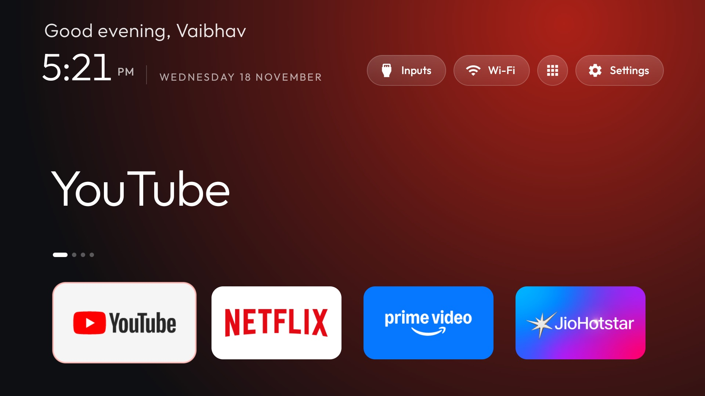
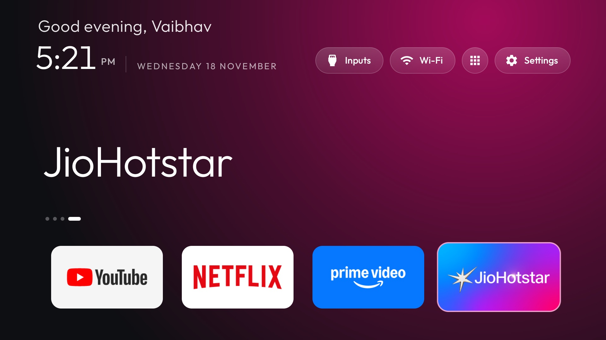
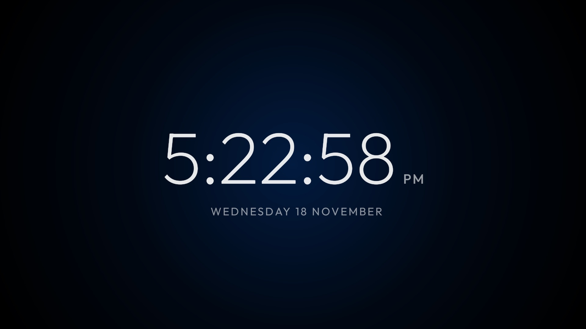

# Android TV Debloat Guide — Xiaomi Mi TV

Turn a slow, ad-filled Xiaomi Mi TV into a fast, clean TV with a minimal home screen and a clock screensaver,
over Wi-Fi, in about 15 minutes. **Nothing is uninstalled and everything can be undone with one command.**

<p align="center">
  
  
</p>
<p align="center">
  
</p>

## What you get

| | Before | After |
|---|---|---|
| Free RAM — higher is better | ~757 MB | **~990 MB** right after reboot, ~910 MB in daily use |
| RAM in use — lower is better | ~1,040 MB | **~850–885 MB** (about 150 MB less) |
| Home screen | Google TV + Xiaomi PatchWall rows, ads, recommendations | Greeting, clock, your 4 apps, glow in each app's colour |
| Screensaver | Xiaomi screensaver | Centred digital clock with running seconds |
| Background telemetry / ads | Xiaomi analytics, statistics, promo feeds, Alexa, demo mode… | 33 apps disabled |
| Menus | Default animations | Instant windows, smooth focus |
| Ads in apps | — | Many blocked via AdGuard Private DNS (not YouTube ads) |
| After power-on | Last source / app | Always Home |

> **RAM, not storage.** The TV has ~1.8 GB of RAM (working memory). Free RAM + RAM in use always add up to that, so more
> free RAM means the disabled apps are no longer running in the background — more room for YouTube, Netflix and the menus.
> Measured with `MemAvailable` in `/proc/meminfo`. Storage barely changes (disabled apps stay on disk so they can be
> re-enabled); on this TV 9.2 GB of 11 GB is free.

Tested on **Xiaomi Mi TV MiTV-MOOQ0 ("croods"), Android TV 10, 1.8 GB RAM**. Other Android TVs work with the
[AI prompt](PROMPT.md) or the [manual guide](docs/SETUP.md), but the app list in `scripts/` is made for this model.

## Quick start (MiTV-MOOQ0)

**1. On the TV:** Settings → Device Preferences → About → press OK on **Build** 7 times → back → **Developer options** →
turn on **USB debugging**. Find the TV's IP under Settings → Network & Internet.

**2. On your computer** (same Wi-Fi as the TV):

```bash
brew install --cask android-platform-tools   # macOS · Windows: winget install Google.PlatformTools · Linux: sudo apt install adb
git clone https://github.com/Vsr4661/android-tv-debloat-guide
cd android-tv-debloat-guide
scripts/install.sh 192.168.1.50 YourName      # your TV's IP, and the name for the greeting
```

**3.** Press **Allow** on the TV when asked (tick *Always allow*). The script disables the apps, installs the launcher,
applies the settings, reboots the TV and prints free memory before and after.

**4.** Turn **USB debugging off** again when you are done.

**Undo everything:** `scripts/undo.sh 192.168.1.50` (add `--remove-launcher` to also delete the launcher).

## Three ways to use this repo

| Way | Best for |
|---|---|
| [`scripts/install.sh`](scripts/install.sh) | Same TV model: one command does everything |
| [`PROMPT.md`](PROMPT.md) | Any Android TV: paste it into Claude Code (or another AI coding agent with a shell) and it audits *your* TV, asks before every change and logs an undo |
| [`docs/SETUP.md`](docs/SETUP.md) | Doing it by hand, step by step, with every adb command explained |

## What gets changed

- **33 apps disabled** with `pm disable-user --user 0`: Xiaomi telemetry (analytics, statistics, TV quality), PatchWall and
  its recommendation/promo rows, Mi TV+ ad channels, Google recommendation feeds and the old launchers, factory/demo
  tools, Alexa, floating pop-ups, feedback/bug-report uploaders, preloaded apps, and the stock Google home.
  Full list with explanations: [docs/APPS.md](docs/APPS.md).
- **Kept on purpose:** HDMI/tuner inputs, Live TV service, Bluetooth remote pairing, remote hotkeys, keyboard, Play Store,
  Play Services, Chromecast, Miracast/Mi Cast, voice search, USB media player, firmware updates.
- **Launcher:** a customised build of the open-source [cleanyourtv](https://github.com/Gathin23/cleanyourtv) launcher
  (MIT) — see [launcher/](launcher/) and [docs/CUSTOMIZE.md](docs/CUSTOMIZE.md).
- **Settings:** window/transition animations 0, animator 0.5; clock screensaver; AdGuard Private DNS; a small
  accessibility helper so the TV always opens Home at power-on.

## Customise

Dock apps, greeting, glow colours, theme, screensaver — all in [docs/CUSTOMIZE.md](docs/CUSTOMIZE.md).
Most changes are one line in `launcher/config.json`, pushed to the TV without reinstalling.

## Repo layout

```
README.md            this page
PROMPT.md            the AI prompt that reproduces this on any Android TV
docs/SETUP.md        manual step-by-step guide
docs/APPS.md         every disabled / kept app and why
docs/CUSTOMIZE.md    launcher settings, colours, rebuilding from source
docs/TROUBLESHOOTING.md  problems we hit and how to fix them
scripts/install.sh   one-command setup (MiTV-MOOQ0)
scripts/undo.sh      one-command undo
scripts/disabled-apps.txt
launcher/            custom launcher APK, its config, source patch and licences
```

## Safety notes

- Apps are **disabled, never uninstalled**: `pm enable` (or `scripts/undo.sh`) brings any of them back. A factory reset also
  restores everything.
- Core Android, the TV input services, the remote, keyboard and Play Store are never touched.
- Network debugging (port 5555) lets anything on your Wi-Fi control the TV. **Turn it off when you finish.**
- Do this at your own risk; it worked on the TV above, but firmware differs between regions and builds.

## Credits & licence

- Launcher, theme ideas and the MiTV-MOOQ0 research: [Gathin23/cleanyourtv](https://github.com/Gathin23/cleanyourtv) (MIT).
  The bundled APK also contains the Outfit font (SIL OFL 1.1) and Fluent Emoji icons (MIT) — licences in [launcher/](launcher/).
- Guide, scripts and launcher changes in this repo: [MIT](LICENSE).
- Not affiliated with Xiaomi, Google or any streaming service; app names and logos belong to their owners.
